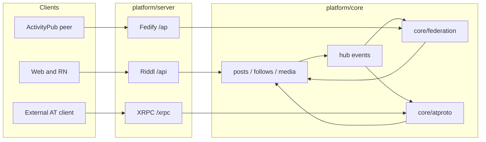

# AT Protocol in OpenPeeps

Planning folder for adding AT Protocol (atproto / Bluesky stack) to OpenPeeps.
The adapter now lives under `platform/core/src/atproto` and
`platform/server/src/atproto`.

## Goal

Give each OpenPeeps community a **community-scoped dual-stack** federation
surface: ActivityPub stays as it is; AT Protocol sits beside it as a second
adapter. OpenPeeps remains the write path, capability gate, and membership
store. Do not turn an instance into a Bluesky clone or a portable global PDS.

## Recommended architecture

OpenPeeps UI keeps talking to Riddl (`/api/*`). Public notes and public
profiles get an instance-bound `did:web` and a signed repo **projection**.
External AT clients talk to `/xrpc/*`. Inbound AT content is ingested only
from an allowlisted set of PDS hosts (same fail-closed model as
`federation.allowedHosts`).

Groups, events, jams, DMs, and anything with visibility other than `public`
never become `app.bsky.*` records and never enter the firehose.

Details: [architecture.md](./architecture.md).

## Why not the other shapes

Documented in [risks.md](./risks.md). Short version:

- **Full portable PDS + `did:plc`.** Conflicts with instance membership,
  roles, and capabilities. A migrated repo would leave the community.
- **AppView / client-only into Bluesky.** Users dual-post to bsky.social.
  That is account linking, not implementing AT in OpenPeeps.
- **AP↔AT bridge.** Two lossy translations, no first-class AT identity,
  repeats the inbound-URI minting problem already present in ActivityPub.

## Phase map

| Phase | What ships                                                             |
| ----- | ---------------------------------------------------------------------- |
| 1     | Identity + read-only PDS-lite (`did:web`, `describeRepo`, `getRecord`) |
| 2     | Outbound projection + local `subscribeRepos`                           |
| 3     | Allowlisted inbound ingest + AppView-lite reads                        |
| 4     | Write XRPC through core mutations + session auth                       |
| 5     | OAuth 2.1 provider for real AT clients                                 |
| 6     | Optional `org.openpeeps.*` lexicons on our AppView only                |

See [phases.md](./phases.md).

## Documents in this folder

| File                                         | Contents                                             |
| -------------------------------------------- | ---------------------------------------------------- |
| [architecture.md](./architecture.md)         | Dual-stack, identity, repo projection                |
| [risks.md](./risks.md)                       | Architectural problems and ActivityPub precedents    |
| [libraries.md](./libraries.md)               | Official AT packages and where they live             |
| [core-integration.md](./core-integration.md) | Modules, schema, hub, config, server mount           |
| [endpoints.md](./endpoints.md)               | Well-known and XRPC surface by phase                 |
| [phases.md](./phases.md)                     | Delivery sequence and test strategy                  |
| [bluesky-compat.md](./bluesky-compat.md)     | Visible AT IDs, Bluesky lookup, gap list, test tiers |

## Current ActivityPub reality

OpenPeeps already federates a narrow ActivityPub slice. The AT adapter must
copy this seam, not extend the Fedify module.

| Concern                                      | Where it lives today                                                                                      |
| -------------------------------------------- | --------------------------------------------------------------------------------------------------------- |
| Actor / object URIs, RSA keys                | [`platform/core/src/federation/identity.ts`](../../platform/core/src/federation/identity.ts)              |
| Local / remote actors                        | [`platform/core/src/federation/actors.ts`](../../platform/core/src/federation/actors.ts)                  |
| Public-note gate                             | [`platform/core/src/federation/notes.ts`](../../platform/core/src/federation/notes.ts)                    |
| Inbound follow / unfollow                    | [`platform/core/src/federation/ingest.ts`](../../platform/core/src/federation/ingest.ts)                  |
| Fail-closed host allowlist                   | [`platform/core/src/federation/peers.ts`](../../platform/core/src/federation/peers.ts)                    |
| Activity ledger                              | [`platform/core/src/federation/activities.ts`](../../platform/core/src/federation/activities.ts)          |
| Fedify Person / Follow / Create Note         | [`platform/server/src/federation/fedify.ts`](../../platform/server/src/federation/fedify.ts)              |
| Hub wiring (`postCreated`, `followCreated`)  | [`platform/server/src/federation/install.ts`](../../platform/server/src/federation/install.ts)            |
| Mount after Riddl `/api/*`                   | [`platform/server/src/server.ts`](../../platform/server/src/server.ts)                                    |
| Config (`federation.active`, `allowedHosts`) | [`platform/common/src/types/config.ts`](../../platform/common/src/types/config.ts)                        |
| Profile / post AP columns                    | [`platform/core/src/db/pg/schema/documents.ts`](../../platform/core/src/db/pg/schema/documents.ts)        |
| E2E harness                                  | [`platform/tests/activitypub/`](../../platform/tests/activitypub/)                                        |
| AT harness                                   | [`platform/tests/atproto/`](../../platform/tests/atproto/) — see [bluesky-compat.md](./bluesky-compat.md) |

What AP does **not** do today (do not assume AT inherits a fix):

- No DID. Actors are `https://{domain}/ap/users/{identifier}`.
- Keys are RSA only (`generateActorKeyPair` in `identity.ts`).
- Only public notes and Follow / Accept / Undo(Follow) federate.
- Inbound `Create` mints a new local post via `createPost` and stores the
  remote Note id only on `ap_activities.object_uri`, not on `posts.uri`.
- Empty `allowedHosts` is fail-closed.

## Other planning docs

This folder is the AT Protocol design. Nearby planning artifacts are unrelated
product work and are **not** superseded:

- [Web vs native parity analysis](../rn-components-vs-react-harmonization-analysis.md)
- [CI review](../ci-review-findings.md)
- [Roadmap timeline](../roadmap-timeline.html)

Implementation, when it starts, follows [AGENTS.md](../../AGENTS.md): one
concern per PR, Drizzle SQL with a snake_case `--name`, no plugin-owned
identity, async ingest on a worker, web and native stay in sync if any UI is
added later.
