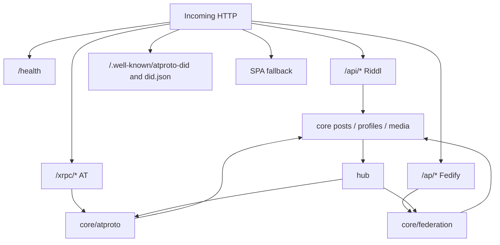
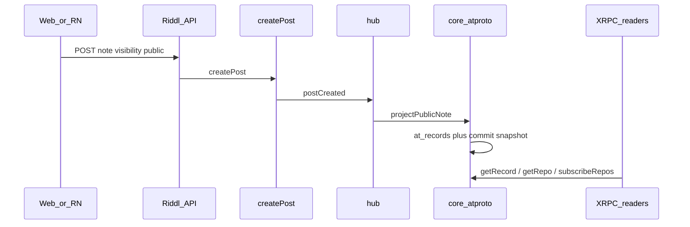
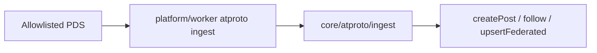

# Architecture

Community-scoped dual-stack. OpenPeeps is the source of truth. AT Protocol is
a projection and a second federation adapter, parallel to ActivityPub.

## Roles

| Role                    | OpenPeeps meaning                                                                            |
| ----------------------- | -------------------------------------------------------------------------------------------- |
| Community app           | Existing web / RN clients via Riddl. Unchanged in v1.                                        |
| Authorization authority | Role capabilities (`core-*`). AT writes must call the same mutations.                        |
| PDS-lite                | Instance serves `did:web` repos for **local** public actors.                                 |
| AppView-lite            | Community-local read methods (`getProfile`, `getAuthorFeed`, …). Not a global Bluesky index. |
| Ingest worker           | Allowlisted `subscribeRepos` consumer. Not a public relay.                                   |

OpenPeeps is **not** a PLC directory, not a full Bluesky AppView, and not a
firehose relay for the network.

## Request paths



Mount order in [`platform/server/src/server.ts`](../../platform/server/src/server.ts)
must keep Riddl on `/api/*` only, then install AT and ActivityPub as separate
non-`/api` trees. See [core-integration.md](./core-integration.md#server-mount).

Fedify is installed **after** Riddl today because `@fedify/express`
eagerly converts every POST to a Web Stream and breaks Riddl body parsing.
XRPC has the opposite constraint: CAR, CBOR, and the `subscribeRepos`
WebSocket must **not** go through the JSON / urlencoded parsers used for
`/api`. Mount `/xrpc` on its own router with method-specific body handling.

## Identity

### Local actor

Each local profile that may federate publicly gets:

- `did:web:{handleDomain}:atproto:users:{handle}`
- Handle `{handle}.{handleDomain}` (AT form), distinct from the AP
  `handle@activityPub.defaultDomain` webfinger form
- A repo signing key (secp256k1 or P-256 via `@atproto/crypto`), **not**
  the RSA key in `profiles.publicKeyPem`

DID document URL:

```
https://{handleDomain}/atproto/users/{handle}/did.json
```

Path-based `did:web` avoids per-user wildcard DNS and certificates. Handle
resolution still needs either:

1. `com.atproto.identity.resolveHandle` on this PDS (always), and
2. HTTP `https://{handle}.{handleDomain}/.well-known/atproto-did` **or**
   DNS TXT `_atproto.{handle}.{handleDomain}` if foreign AppViews must
   resolve the handle without calling us.

v1 can ship (1) only. (2) is an ops decision; flag the cost in
[risks.md](./risks.md#9-handles).

Do **not** reuse AP paths (`/ap/users/{id}`) as the DID document location.
AP actors stay at
[`ACTOR_PATH`](../../platform/core/src/federation/identity.ts).

### Remote AT actor

`profiles.type = 'federated'` with a DID and `pds_endpoint`, no AP inbox.
Lookups are by `did`, not by `profiles.uri`. A single remote person who
exists on both AP and AT is two profile rows until a later linking feature
exists — do not merge on handle.

### Portability

v1 is instance-bound `did:web`. No `did:plc` creation, no repo migration
endpoint. Resolving a foreign `did:plc` for ingest is allowed (read-only
PLC directory).

## Repo projection

Postgres remains the write path. The AT repo is derived.



Rules:

- Only `type === 'note'` and `visibility === 'public'` become
  `app.bsky.feed.post`. Same gate as
  [`loadPublicNote`](../../platform/core/src/federation/notes.ts).
- `rkey` is a TID (or a stable function of `posts.id` that is a valid TID).
  Store it on `at_records`; do not re-derive from UUID in a way that can
  drift.
- `posts.at_uri` is the canonical AT id (`at://{did}/app.bsky.feed.post/{rkey}`).
  Keep `posts.uri` for the AP `https://…/ap/objects/{id}` object.
- MST / CAR bytes live in `at_repo_commits` for `com.atproto.sync.getRepo`.
  Rebuild on the worker if the repo is large; a single-record append may
  stay in-process like `federatePublicNote`.

External AT writes (phase 4+) invert the arrow: XRPC `createRecord` →
capability check → `createPost` → hub → projection (idempotent on `at_uri`).

## Record mapping (v1)

| Lexicon                  | OpenPeeps                                                          |
| ------------------------ | ------------------------------------------------------------------ |
| `app.bsky.actor.profile` | Local profile display name, bio, public avatar                     |
| `app.bsky.feed.post`     | Public note body + reply `at://` ref                               |
| `app.bsky.graph.follow`  | Follow edge to another AT actor (local or federated)               |
| `app.bsky.feed.like`     | Phase 4+. Only a designated like; other emoji reactions stay local |

Not mapped: group posts, DMs, local/unlisted, articles, events, jams,
polls, RSVPs, announces beyond a later explicit `app.bsky.feed.repost`.

## Ingest

Worker (not the request path) opens `subscribeRepos` to each allowlisted
PDS, or to a relay **filtered** by those DIDs/hosts.



Inbound post rules:

- Reject if PDS host is not in `atproto.allowedPdsHosts` (empty = fail
  closed, copy
  [`peerHostAllowed`](../../platform/core/src/federation/peers.ts)).
- Upsert remote profile by DID.
- `createPost` with `visibility: 'public'` and set `posts.at_uri` + `cid`
  to the **remote** record id. Do not mint a second AT identity.
- Dedup on `at_uri` / CID, not on a newly generated local object URI.

This is the fix AT must not copy from AP inbound `Create` in
[`fedify.ts`](../../platform/server/src/federation/fedify.ts) (remote Note
id is only stored on `ap_activities.object_uri`).

## Dual-protocol posts

A local public note may federate on **both** protocols from the same hub
event:

- `installFederation` → `federatePublicNote`
- `installAtproto` → `projectPublicNote`

They share `createPost` / `posts.id`. They do **not** share URI columns,
keys, or ledgers.

A remote AP note and a remote AT note are different objects even if the
text matches. No automatic AP↔AT translation.

## Authz

| Client                                      | Auth                                                | Allowed writes                                                   |
| ------------------------------------------- | --------------------------------------------------- | ---------------------------------------------------------------- |
| Web / RN                                    | Existing community JWT + capabilities               | All OpenPeeps visibilities, via Riddl                            |
| AT client (phase 4 session / phase 5 OAuth) | AT session or OAuth DPoP, mapped to a local profile | Public `app.bsky.*` collections only, through the same mutations |
| Ingest worker                               | Service credential to remote PDS                    | No requester identity; cannot grant community capabilities       |

Missing or unverifiable requester authorization fails closed. Service
credentials authenticate the worker, not a user.

## What stays out of the architecture

- Custom `org.openpeeps.group.*` / event / jam lexicons until phase 6, and
  only on our AppView.
- Ozone / labeler stack. Community moderation stays on OpenPeeps roles.
- `chat.bsky.*`. Direct messages stay `visibility: 'direct'`.
- Hosting `bsky.network` or becoming a public relay.
