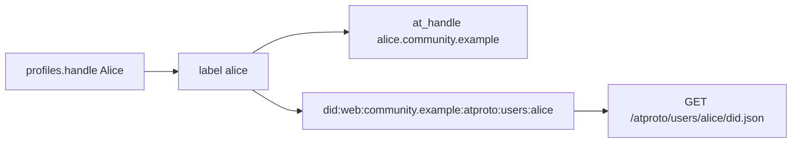

# Bluesky compatibility tests and AT user IDs

How OpenPeeps mints the identifiers a Bluesky client would show, how the
public network actually looks people up, what still blocks a `bsky.app`
follow, and the three test tiers that close that gap in order.

This is the test plan. CAR, CBOR firehose, allowlisted ingest, and
`requestCrawl` now live in the AT adapter. Remaining public-network
work is operator DNS/TLS and a live `bsky.network` crawl.

Harness: [`platform/tests/atproto/`](../../platform/tests/atproto/).

## How visible AT user IDs are created

OpenPeeps users keep their community `profiles.handle` (and AP
`handle@domain`). AT Protocol adds two **separate** public identifiers,
minted in
[`platform/core/src/atproto/identity.ts`](../../platform/core/src/atproto/identity.ts)
when a local profile is backfilled or created (`localAtprotoScalars` /
`backfillLocalAtprotoIdentities`).

**What people see (handle):** `{label}.{handleDomain}`

- `label` is `sanitizeAtHandleLabel(profile.handle)`: lowercase,
  `a-z0-9-` only, no leading hyphen, max 63 chars; empty → `user`.
- `handleDomain` comes from config `atproto.handleDomain` (default
  `localhost`).
- Example: OpenPeeps handle `Alice!` on `community.example` → AT handle
  `alice.community.example`.
- Stored on `profiles.at_handle`. This is the `@alice.community.example`
  string Bluesky clients would show.

**Stable machine ID (DID):** `did:web:{handleDomain}:atproto:users:{label}`

- Example: `did:web:community.example:atproto:users:alice`.
- Document URL: `https://community.example/atproto/users/alice/did.json`.
- The document’s `alsoKnownAs` is `at://alice.community.example`.
- `#atproto_pds` service points at `https://{handleDomain}`.
- Signing key is secp256k1 (`@atproto/crypto`), not the AP RSA key.

**Post IDs:** `at://{did}/app.bsky.feed.post/{rkey}` (`rkeyFromPostId` is
a stable hash of `posts.id`). Stored on `posts.at_uri`.

These IDs are **instance-bound**. There is no `did:plc` and no portable
handle like `alice.bsky.social`. A user who leaves the community does not
take this identity onto Bluesky’s PDS.

### How Bluesky actually looks people up

This is the interop hinge:

- Official AppView does **not** call our
  `com.atproto.identity.resolveHandle` first.
- It resolves `alice.community.example` via DNS TXT
  `_atproto.alice.community.example` or HTTPS
  `https://alice.community.example/.well-known/atproto-did`.
- Today we only serve `/.well-known/atproto-did` when the **request Host**
  is already `{handle}.{handleDomain}`. That needs wildcard DNS + TLS.
- Path-based `did:web` is spec-valid; Bluesky’s AppView historically
  indexes `did:plc` from `bsky.network` much more reliably.

## Current gaps vs the public Bluesky network

Protocol surfaces that blocked membership are in place:

- [`getRepo`](../../platform/server/src/atproto/xrpc.ts) returns a signed
  IPLD CAR (`application/vnd.ipld.car`).
- [`subscribeRepos`](../../platform/server/src/atproto/subscribe.ts) is
  the CBOR WebSocket firehose (`#commit` frames, local repos only).
- Record CIDs are dag-cbor (`bafy…`) from `@atproto/repo`.
- Authenticated `com.atproto.sync.requestCrawl` calls
  `{relayUrl}/xrpc/com.atproto.sync.requestCrawl` (default
  `https://bsky.network`).
- Operators either publish `_atproto.{handle}` TXT from the admin
  handle-DNS settings (Cloudflare / Hetzner / DigitalOcean) or serve
  handle hosts on `*.{handleDomain}`. See
  [AT Protocol handles and DNS](../../platform/web/docs/admin/atproto.md).

Do not schedule a public `bsky.app` follow test until that DNS/TLS is
live and `requestCrawl` has been called against a real relay.

## Test plan (three tiers)

### Tier 0 — Identity and lexicon conformance (no Bluesky account)

Script against a local instance with `atproto.active: true`. Prefer
official packages (`@atproto/identity`, `@atproto/xrpc`,
`@atproto/lexicon`, later `@atproto/repo`).

- DID document: `GET /atproto/users/{label}/did.json` parses with
  `@atproto/identity` `DidResolver` (`did:web`).
- Handle: `com.atproto.identity.resolveHandle?handle=alice.community.example`
  returns that DID.
- Public note created via Riddl appears as `app.bsky.feed.post` on
  `getRecord` / `listRecords`; local/group/direct do not.
- Session JWT is rejected by Riddl `/api` (already unit-tested in
  [`sessions.test.ts`](../../platform/core/src/atproto/sessions.test.ts)).
- Optional: `@atproto/api` `Agent` against our origin for `getProfile` /
  `getAuthorFeed`.

Lives at [`platform/tests/atproto/`](../../platform/tests/atproto/)
(script + README, not on every PR). Same style as
[`platform/tests/activitypub/`](../../platform/tests/activitypub/).

### Tier 1 — Lab interop with a real AT client or second PDS

CAR + CBOR `subscribeRepos` exist. Extend
[`test-lab.mjs`](../../platform/tests/atproto/test-lab.mjs) (do not
invent a second test tree) with a reference PDS/client compose:

Compose: OpenPeeps + one reference PDS (or a second OpenPeeps), Traefik
TLS, fail-closed allowlists. Mirror the AP harness.

Outbound (we are the PDS):

- Reference client (goat / official lexicon client / Deer pointed at our
  XRPC) logs in via `createSession` or OAuth+DPoP.
- Client `getProfile` / `getAuthorFeed` / `getPostThread` for
  `alice.community.example`.
- Client `createRecord` of a public post; it appears in the OpenPeeps
  Riddl feed as `visibility: public`.

Inbound (we ingest them):

- Add the peer PDS host to `atproto.allowedPdsHosts`.
- Enqueue an ingest of one `app.bsky.feed.post`; assert `posts.at_uri`
  is the **remote** AT-URI (no second minted id).
- A host not on the allowlist is dropped.

This answers “are we speaking AT Protocol?” without joining
`bsky.network`. The scaffold and skip gate live in
[`platform/tests/atproto/test-lab.mjs`](../../platform/tests/atproto/test-lab.mjs).

### Tier 2 — Public Bluesky network (optional, after protocol gaps)

Only after real CAR + CBOR `subscribeRepos` + handle DNS/HTTP:

1. Public HTTPS instance; `handleDomain` is a real DNS name.
2. Wildcard `*.{handleDomain}` (or per-user TXT) so Bluesky can resolve
   the visible handle to our DID.
3. Call `com.atproto.sync.requestCrawl` on `bsky.network` with our PDS
   host.
4. Manual: from the official Bluesky app, search `@alice.{handleDomain}`;
   profile and public notes appear.
5. Manual inbound: allowlist a single Bluesky PDS host (not the whole
   firehose); ingest one followed DID; that user’s public posts appear as
   `type=federated` in OpenPeeps.

Do **not** subscribe to the full `bsky.network` firehose. Keep
`allowedPdsHosts` fail-closed.
