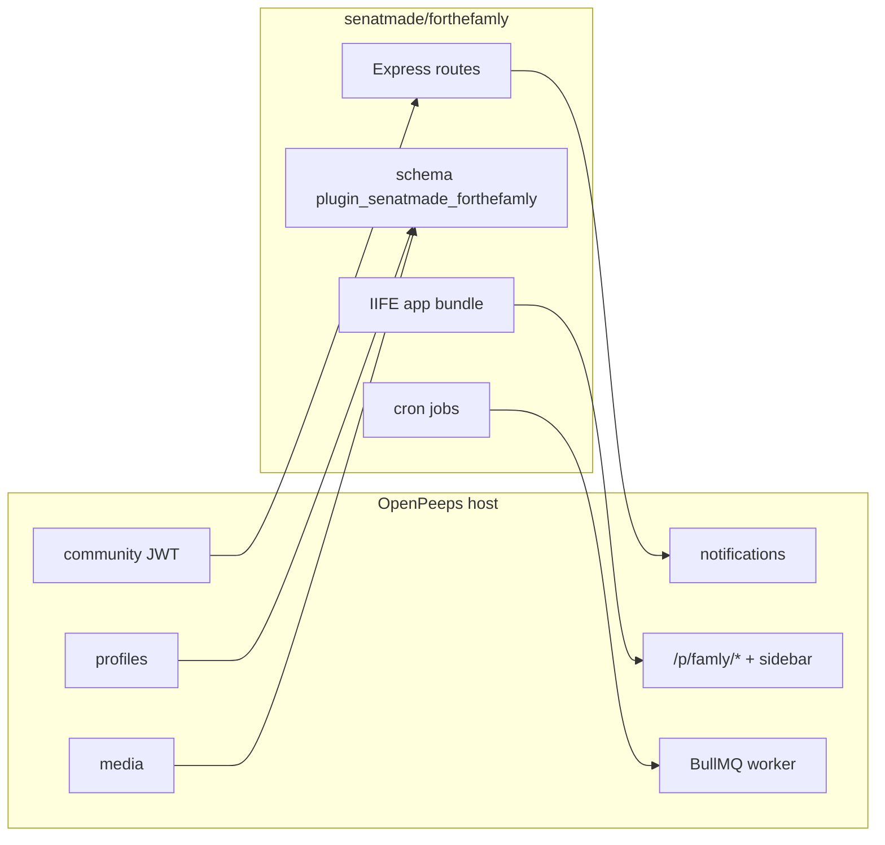

# ForTheFamly as an OpenPeeps plugin

Planning docs for turning
[ForTheFamly](https://github.com/senatmade-openpeeps/ForTheFamly)
(`allpeep/ForTheFamly` on disk) into a community plugin, and for the host
API gaps that work requires.

ForTheFamly is a standalone Next.js SaaS (~40k LOC, 31 tables, own auth,
Stripe, marketing). OpenPeeps plugins today are in-process Node modules plus
IIFE slot widgets. The only in-repo example is
`examples/greeter-plugin/`.

Authoritative plugin contract:
[`platform/web/docs/development/plugins.md`](../../platform/web/docs/development/plugins.md).

## Decisions

| Decision | Choice |
| --- | --- |
| v1 product | Families, agreements, signoffs, kid home, stars/rewards |
| Auth / identity | OpenPeeps profiles + community JWT |
| Media | OpenPeeps media ids (no data-URLs in Postgres) |
| Notifications | Host in-app / push / email |
| Billing | Out of v1 (drop Stripe Famly/Work, trials, seats) |
| Marketing / blog / FTF login | Stay on forthefamly.org; not in the plugin |
| Families vs OpenPeeps groups | Plugin-owned families (roles are parent/child/mentor/guardian) |
| Tenancy | One OpenPeeps community = one FTF tenant |
| Repo | New plugin repository, distinct from the ForTheFamly SaaS codebase and from OpenPeeps. Install from git / plugin store |
| Native UI | Web-only v1; native gets a named stub route |

## Architecture

## Reading order

1. [Gap analysis](01-gap-analysis.md) — current plugin surface vs FTF needs
2. [Host: app pages](02-host-pages.md) — `/p/:basePath`, nav, CSS
3. [Host: persistence](03-host-persistence.md) — namespaced SQL migrations
4. [Host: jobs and notifications](04-host-jobs.md) — worker load + cron
5. [Domain mapping](05-domain-mapping.md) — tables, roles, APIs to keep/drop
6. [Plugin port](06-plugin-port.md) — package layout, UI, API rewrite
7. [Delivery](07-delivery.md) — PR order, fixtures, publish

## Delivery at a glance

OpenPeeps (three small sequential PRs), then the **new plugin repo**
(skeleton → domain → kid/gamification → jobs → store tarball). The current
ForTheFamly SaaS stays as the reference implementation and marketing site.
Details in [07-delivery.md](07-delivery.md).
